<h2 data-importer="text" align="left">Wassup! My name is Iaroslav and I'm a DevOps engineer, from Russia</h2>

###

  
  

###

###

  
  
  
  
  
  
  
  
  
  
  
  
  
  
  
  
  
  
  
  
  
  
  
  
  
  
  

###

  
  
  

###

 

###
